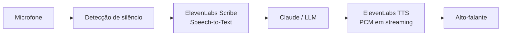

# Assistente Virtual por Voz

Um assistente de voz em Python feito para portfólio: escuta o microfone, usa **ElevenLabs Scribe** para transcrever, **Claude** para elaborar uma resposta contextual e **ElevenLabs TTS** para responder em voz do JARVIS do Homem de Ferro. A conversa continua até você dizer “tchau” ou “encerrar”.

> As respostas foram pensadas para fala: curtas, naturais e configuráveis pelo `SYSTEM_PROMPT`.

## Demonstração

Exemplo no terminal:

```text
Assistente pronto. Fale após 'Ouvindo…'. Diga 'tchau' ou 'encerrar' para sair.

Ouvindo…
Você: qual é a capital do Brasil?
Assistente: A capital do Brasil é Brasília.

Ouvindo…
Você: tchau
Assistente: Até logo!
```

## Fluxo



## Recursos

- Gravação com encerramento automático após silêncio configurável.
- Transcrição em português brasileiro por padrão, com idioma configurável.
- Memória curta da conversa com limite de mensagens.
- Camada de LLM isolada em `llm.py`, facilitando substituir Claude por outro provedor.
- TTS em PCM por streaming para começar a tocar antes de todo o áudio terminar de chegar.
- Saída por voz (“tchau”/“encerrar”) ou `Ctrl+C`.
- Mensagens claras para falhas de microfone, configuração e APIs; `--debug` mostra detalhes técnicos.
- Testes unitários sem chamadas reais às APIs.

## Pré-requisitos

- Python 3.10 ou superior.
- Uma conta e chave de API da [ElevenLabs](https://elevenlabs.io/app/settings/api-keys), com acesso a Scribe e Text-to-Speech.
- Uma conta e chave da [Anthropic](https://console.anthropic.com/settings/keys).
- Microfone e alto-falantes configurados no sistema.

### Dependências de áudio por sistema

`sounddevice` usa PortAudio. Em geral, no Windows e macOS basta instalar as dependências Python. No Linux, instale também o pacote do sistema antes do `pip`:

```bash
# Debian/Ubuntu
sudo apt install portaudio19-dev libsndfile1

# Fedora
sudo dnf install portaudio-devel libsndfile

# macOS (apenas se necessário)
brew install portaudio libsndfile
```

## Instalação

1. Clone ou baixe este repositório e entre na pasta:

   ```bash
   git clone https://github.com/SEU-USUARIO/voice-assistant.git
   cd voice-assistant
   ```

2. Crie e ative um ambiente virtual:

   ```bash
   # Windows (PowerShell)
   py -m venv .venv
   .\.venv\Scripts\Activate.ps1

   # macOS/Linux
   python3 -m venv .venv
   source .venv/bin/activate
   ```

3. Instale o projeto e as dependências:

   ```bash
   python -m pip install --upgrade pip
   pip install -r requirements.txt
   pip install -e .
   ```

4. Copie o modelo de configuração e preencha as chaves:

   ```bash
   # Windows (PowerShell)
   Copy-Item .env.example .env

   # macOS/Linux
   cp .env.example .env
   ```

5. Abra `.env` e informe `ELEVENLABS_API_KEY` e `ANTHROPIC_API_KEY`. Nunca envie esse arquivo para o GitHub.

## Como executar

```bash
voice-assistant
# ou, sem instalar o comando:
python -m voice_assistant.main
```

Para logs detalhados de diagnóstico:

```bash
voice-assistant --debug
```

Fale depois de `Ouvindo…`. A gravação começa quando sua voz ultrapassa o limiar e termina após o período de silêncio. Diga **tchau** ou **encerrar** para finalizar.

## Configuração

Todas as variáveis vivem em `.env`; veja o arquivo [`.env.example`](.env.example).

| Variável | Padrão | Descrição |
| --- | --- | --- |
| `LANGUAGE_CODE` | `pt` | Idioma esperado pelo Scribe (por exemplo, `en`, `es`). |
| `ELEVENLABS_STT_MODEL` | `scribe_v2` | Modelo de transcrição. |
| `ELEVENLABS_TTS_MODEL` | `eleven_multilingual_v2` | Modelo de voz. |
| `ELEVENLABS_VOICE_ID` | voz padrão | ID de uma voz disponível na sua conta ElevenLabs. |
| `ANTHROPIC_MODEL` | `claude-sonnet-4-5-20250929` | Modelo Claude a usar. Ajuste conforme sua conta. |
| `SYSTEM_PROMPT` | assistente breve | Personalidade e estilo das respostas. |
| `MAX_HISTORY_MESSAGES` | `12` | Memória recente; use número par. |
| `SILENCE_THRESHOLD` | `0.015` | Sensibilidade de detecção. Reduza se o microfone estiver baixo; aumente se houver ruído. |
| `SILENCE_DURATION_SECONDS` | `1.2` | Tempo de silêncio que encerra a fala. |
| `INPUT_DEVICE` | vazio | Índice numérico do microfone; vazio usa o dispositivo padrão. |

## Solução de problemas

| Problema | Possível solução |
| --- | --- |
| “Nenhuma fala detectada” | Fale mais perto do microfone ou diminua `SILENCE_THRESHOLD` (por exemplo, `0.008`). |
| Microfone não abre | Confirme a permissão do terminal em Privacidade/Segurança e deixe `INPUT_DEVICE` vazio para testar o padrão. |
| Chave/API falha | Confira as chaves em `.env`, créditos e permissões nas contas ElevenLabs/Anthropic. |
| Sem áudio de saída | Verifique o dispositivo de reprodução padrão; no Linux, instale `portaudio` e `libsndfile`. |
| Modelo indisponível | Troque `ANTHROPIC_MODEL` ou os modelos ElevenLabs pelos que sua conta suporta. |

## Testes

```bash
pytest -q
```

Os testes usam mocks para que não precisem de microfone, internet nem chaves de API.

## Roadmap

- [ ] Atalho para listar e selecionar dispositivos de áudio.
- [ ] Interface gráfica ou web.
- [ ] Detecção de palavra de ativação.
- [ ] Armazenamento opcional e consentido de conversas.
- [ ] Testes de integração com APIs em ambiente separado.

## Licença

Distribuído sob a [licença MIT](LICENSE).

---

## English (short version)

**Voice Assistant** is a Python 3.10+ portfolio project that records microphone speech, transcribes it with ElevenLabs Scribe, generates a contextual reply through Claude, and streams ElevenLabs TTS PCM audio to the speaker. Copy `.env.example` to `.env`, add your ElevenLabs and Anthropic keys, then run `pip install -r requirements.txt`, `pip install -e .`, and `voice-assistant`. Say “tchau”/“encerrar” or press `Ctrl+C` to quit. See the Portuguese sections above for full setup, configuration, troubleshooting, tests, and licensing.
